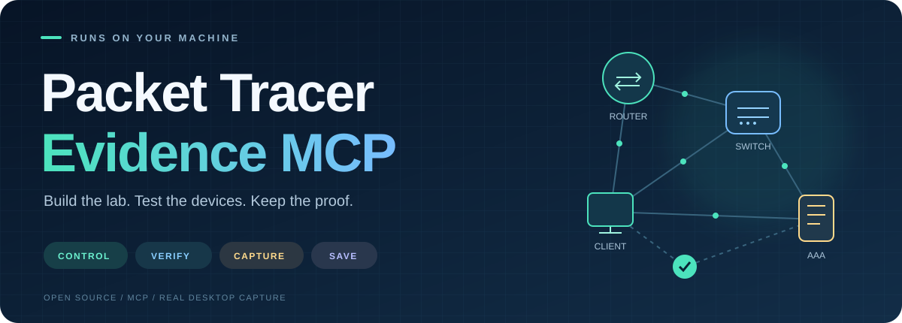
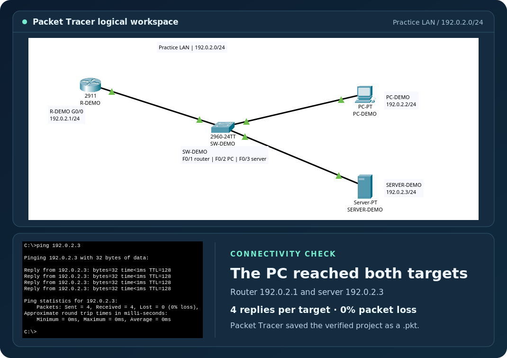

<p align="center">
  
</p>

<h1 align="center">Packet Tracer MCP</h1>

<p align="center">
  <a href="https://github.com/Adam-ZS/packet-tracer-mcp/actions/workflows/ci.yml"></a>
  <a href="https://github.com/Adam-ZS/packet-tracer-mcp/releases/latest"></a>
  <a href="LICENSE"></a>
  <a href="https://github.com/Adam-ZS/packet-tracer-mcp/stargazers"></a>
</p>

<p align="center">
  <a href="https://github.com/Adam-ZS/packet-tracer-mcp/releases/latest"><strong>Download latest release</strong></a> ·
  <a href="#quick-start">Quick start</a> ·
  <a href="#live-showcase">Live showcase</a> ·
  <a href="docs/AI_GUIDE.md">AI tool guide</a> ·
  <a href="docs/HEADLESS.md">Headless Linux</a>
</p>

Let your MCP client place routers, switches, PCs and servers in Cisco Packet
Tracer. It can cable the devices, configure IOS and IPv4, test connectivity
from a simulated PC and save the verified `.pkt`. When you need a report, it
can capture the live simulator and insert those screenshots into a Word template.

## Live showcase



The PC in this run reached both the router and server with four replies and
zero packet loss. [Full-size topology](docs/assets/demo-topology.png) ·
[Ping capture](docs/assets/demo-ping.png) · [Test details](docs/VALIDATION.md)

<details>
<summary><strong>Watch Packet Tracer build the LAN</strong></summary>


Recorded from the live Linux/Xvfb simulator while `pt-evidence demo` ran.

</details>

## Build your first LAN

Open a blank Packet Tracer project after [setup](#quick-start) and tell your MCP client:

> Call `pt_build_practice_lan` and save the result as `practice-lan.pkt`.
> Report the actual ping results from the PC to the router and server.

The starter LAN uses `192.0.2.0/24` and saves after both pings pass. For a
custom layout, see the [AI tool guide](docs/AI_GUIDE.md).

## Quick start

You need Python 3.11 or newer and a running, signed-in copy of Cisco Packet
Tracer. Live operation was tested on Linux/X11.

1. Download the **MCP Control Center** `.pts` module from the
   [upstream releases](https://github.com/Mats2208/MCP-Packet-Tracer/releases).
   In Packet Tracer, open **Extensions → Scripting → Configure PT Script Modules**,
   add the module, select it and click **Start** if prompted. Keep Packet Tracer running.
2. Install the MCP server from the release wheel in a virtual environment.

   ```bash
   mkdir -p packet-tracer-mcp
   cd packet-tracer-mcp
   python3 -m venv .venv
   source .venv/bin/activate
   python -m pip install 'https://github.com/Adam-ZS/packet-tracer-mcp/releases/download/v0.2.0/packettracer_evidence_mcp-0.2.0-py3-none-any.whl'
   export PT_WORKSPACE="$PWD/workspace"
   pt-evidence doctor --live
   ```

   To develop from a clone, see the [source setup](CONTRIBUTING.md).

3. Copy this into a client that supports the `mcpServers` JSON format.
   Use the absolute path to the directory you created in step 2 for both
   entries. This gives the terminal and MCP client the same workspace.

   ```json
   {
     "mcpServers": {
       "packet-tracer": {
         "command": "/absolute/path/packet-tracer-mcp/.venv/bin/pt-evidence",
         "args": ["serve"],
         "env": {
           "PT_WORKSPACE": "/absolute/path/packet-tracer-mcp/workspace"
         }
       }
     }
   }
   ```

4. Reconnect the client. Check that it can call `pt_status` and that
   `extension_alive` is true. Then try the [starter LAN](#build-your-first-lan).

The server uses local stdio and the Control Center file mailbox. It needs
no AI provider API key of its own. To override mailbox discovery or enable the
optional Linux desktop controls, see [configuration](docs/CONFIGURATION.md).

You can run the same demo from a terminal with a blank Packet Tracer canvas.
The command returns JSON, including both ping results and the saved path.
To continue working in Packet Tracer, open the `.pkt` at that path. For a
custom lab, start with the [tool guide](docs/AI_GUIDE.md).

```bash
pt-evidence demo --output practice-lan.pkt
```

For a Linux machine without a physical display, run Packet Tracer on Xvfb.
The MCP server and terminal demo can connect to the mailbox with no display
variables. See the [headless setup](docs/HEADLESS.md).

## Build a custom network

| Task | Tools |
| --- | --- |
| Inspect devices and exact interface names | `pt_status`, `pt_devices` |
| Place and label nodes | `pt_add_device`, `pt_move_device`, `pt_add_note`, `pt_center_canvas` |
| Draw actual cables between ports | `pt_connect` |
| Set PC or Server-PT IP, mask and gateway | `pt_pc_ip` |
| Configure IOS, run commands and check output | `pt_configure_ios`, `pt_terminal`, `pt_read_console` |
| Configure or toggle simulated RADIUS | `pt_radius_setup`, `pt_radius_service` |
| Open and save Packet Tracer files | `pt_open_project`, `pt_save_project`, `pt_project_info` |
| Export evidence and fill a report | `pt_capture`, `pt_verify_evidence`, `pt_export_transcript`, `pt_fill_report` |

Supported models are **2911**, **ISR4331**, **2960-24TT**, **PC-PT**, and
**Server-PT**. For example, a PC on `FastEthernet0` can connect to a switch's
`FastEthernet0/2` with `cable: "straight"`. Use the port names returned by
`pt_devices` for the chosen model. The [AI tool guide](docs/AI_GUIDE.md)
shows concrete cable, IP, IOS and verification calls.

Ask your agent for something specific, such as:

> Build a 2911 router, a 2960 switch, two PCs and a Server-PT. Lay out the
> router above the switch and the three hosts below it. Use separate switch
> ports. Assign addresses in 192.0.2.0/24, ping the server from both PCs,
> and save the verified project as `two-clients.pkt`.

## Capture evidence

`pt_capture` returns the actual desktop image and saves the original PNG, an
optional exact crop and a JSON manifest. `pt_verify_evidence` checks the hashes
and crop pixels against that manifest. Review the visible screen before
capturing or sharing it.

For a report, put text placeholders such as `{{NAME}}` and standalone image
placeholders such as `{{EVIDENCE:ping}}` in a DOCX template. `pt_fill_report`
inserts text and verified crops into a new copy. See the
[evidence and Word walkthrough](docs/WORKFLOWS.md).

<p align="center"></p>

## Compatibility

- Live Packet Tracer and screenshot capture were tested on **Linux/X11 and Xvfb**.
  Windows, macOS and Wayland live behavior still need verification.
- The available IOS commands depend on the selected simulated device. See
  [troubleshooting](docs/TROUBLESHOOTING.md) for setup dialogs, ports and prompts.
- Run one controller per Packet Tracer session. The extension, client and server
  run with the local user's privileges. See [security](SECURITY.md) for details.

## Contribute

Try the starter LAN and report your OS, Packet Tracer version and result in
[GitHub Discussions](https://github.com/Adam-ZS/packet-tracer-mcp/discussions).
Star the project if it helps with your labs. For code changes, start with
[CONTRIBUTING.md](CONTRIBUTING.md).

Maintained by [Adam-ZS](https://github.com/Adam-ZS). Layout, evidence capture
and report tooling use the separately installed Control Center from
[Mats2208/MCP-Packet-Tracer](https://github.com/Mats2208/MCP-Packet-Tracer).
See the [MIT license](LICENSE) and [upstream notices](THIRD_PARTY_NOTICES.md).
