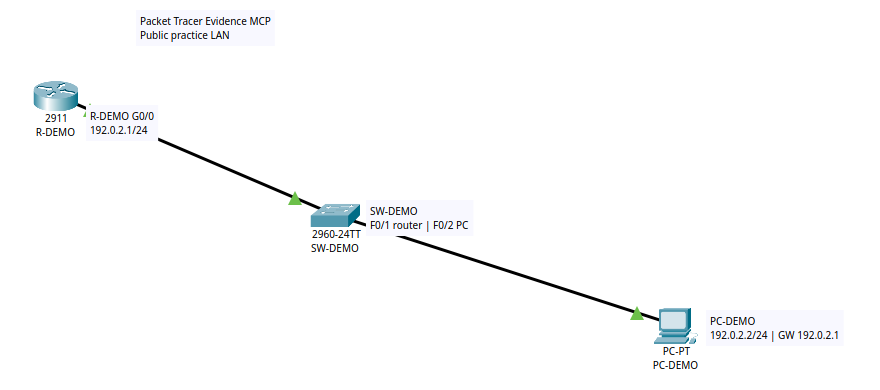
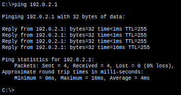
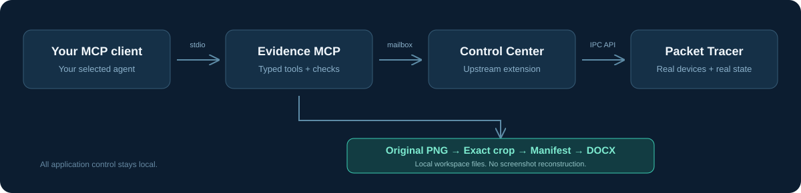

<p align="center">
  
</p>

<p align="center">
  <a href="https://github.com/Adam-ZS/packettracer-evidence-mcp/actions/workflows/ci.yml"></a>
  <a href="LICENSE"></a>
  <a href="pyproject.toml"></a>
  <a href="https://github.com/Adam-ZS/packettracer-evidence-mcp/stargazers"></a>
</p>

<p align="center"><b>Build the lab. Test the devices. Keep the proof.</b><br />
Live Cisco Packet Tracer control, genuine desktop screenshots and template-based Word reports through MCP.</p>

<p align="center">
  <a href="#quick-start">Quick start</a> ·
  <a href="#what-it-does">Tools</a> ·
  <a href="docs/WORKFLOWS.md">Workflows</a> ·
  <a href="docs/TROUBLESHOOTING.md">Troubleshooting</a> ·
  <a href="CONTRIBUTING.md">Contribute</a>
</p>

## What it does

Give an MCP client access to your running Packet Tracer session. Inspect actual
ports, place devices, configure routing and AAA, wait for terminal prompts,
and capture the visible application after checking the results.

Every capture keeps the full desktop original, a lossless crop and a JSON
manifest. Verification checks SHA-256 hashes and compares the crop's pixels
with the original. Screenshots are never drawn from console text.

| Task | Tools |
| --- | --- |
| Inspect the live project | `pt_status`, `pt_devices`, `pt_read_console` |
| Build and arrange devices | `pt_new_project`, `pt_add_device`, `pt_connect`, `pt_move_device`, `pt_add_note`, `pt_center_canvas` |
| Configure and test | `pt_pc_ip`, `pt_configure_ios`, `pt_terminal` |
| Test server availability | `pt_radius_setup`, `pt_radius_service` |
| Save the work | `pt_project_info`, `pt_save_project`, `pt_open_project`, `pt_export_transcript` |
| Record actual evidence | `pt_capture`, `pt_verify_evidence`, `pt_fill_report` |
| Operate visible windows, optional | `pt_focus_window`, `pt_desktop_action` |

The device choices are deliberately small: **2911, ISR4331, 2960-24TT, PC-PT
and Server-PT**. Inspect ports instead of assuming that all routers use the
same interface names.

## A real run

| Live topology | Verified connectivity |
| --- | --- |
|  |  |

These are genuine crops captured through `pt_capture` after live MCP commands.
The practice LAN uses documentation addresses and contains no course material
or student identity. See the [validation record](docs/VALIDATION.md) for what
was checked and what remains unverified.

## Quick start

### 1. Prepare Packet Tracer

Install and sign in to your own copy of Cisco Packet Tracer. Install the
**MCP Control Center** `.pts` extension from
[Mats2208/MCP-Packet-Tracer releases](https://github.com/Mats2208/MCP-Packet-Tracer/releases)
using **Extensions → Scripting → Configure PT Script Modules → Add**.
Keep the extension enabled and Packet Tracer open.

This repository is a separate evidence-focused MCP server compatible with that
extension. The upstream project supplies the in-application bridge and its
native device helpers. See [credits](THIRD_PARTY_NOTICES.md).

### 2. Install this server

```bash
git clone https://github.com/Adam-ZS/packettracer-evidence-mcp.git
cd packettracer-evidence-mcp
python3 -m venv .venv
source .venv/bin/activate
python -m pip install -e .

export PT_WORKSPACE="$PWD/workspace"
pt-evidence doctor --live
```

`doctor` should report `"extension_alive": true` and list the live devices.
If it cannot find the mailbox, set `PT_BRIDGE_DIR` to the extension's `bridge`
directory. It must contain a recently updated `alive.txt`. See
[configuration](docs/CONFIGURATION.md) for discovery paths and desktop setup.

### 3. Connect an MCP client

Use the absolute path to your virtual environment's executable. Replace the
paths below with your own. This is the common `mcpServers` JSON format; the
exact settings file depends on your client.

```json
{
  "mcpServers": {
    "packettracer-evidence": {
      "command": "/absolute/path/packettracer-evidence-mcp/.venv/bin/pt-evidence",
      "args": ["serve"],
      "env": {
        "PT_WORKSPACE": "/absolute/path/my-packet-tracer-work"
      }
    }
  }
}
```

Restart or reconnect your MCP client, then ask:

> Inspect my open Packet Tracer project. Build a small practice LAN with a
> router, switch and PC. Use 192.0.2.0/24, verify a successful ping, capture
> the actual result and topology, and save demo.pkt. Ask before discarding
> unsaved work.

The server uses **stdio**. It does not start an HTTP listener.

## A terminal session that waits for the right state

Send commands individually when a device asks questions. A password prompt is
different from an EXEC prompt, and RSA key generation asks for a modulus.

```python
# Example MCP tool calls in Python-like syntax:
pt_terminal(device="PC-A", command="ssh -l operator 192.0.2.1", expect_regex=r"Password:\s*$")
pt_terminal(device="PC-A", command="your-lab-password", secret=True, expect_regex=r"R-DEMO[>#]\s*$")
pt_terminal(device="PC-A", command="show privilege", expect_regex=r"R-DEMO[>#]\s*$")
```

These are tool calls from an MCP client, not top-level Python imports. Inspect
`matched`, `timed_out` and the real output. An error followed by a valid prompt
is still an error. There is no automatic retry after an uncertain mutation.

## Evidence you can inspect

```text
workspace/
├── demo.pkt                      saved by Packet Tracer itself
└── evidence/<timestamp>_<id>/
    ├── original.png              real desktop capture
    ├── crop.png                  exact rectangular crop
    └── manifest.json             coordinates, time and SHA-256 hashes
```

Call `pt_capture(label="Successful ping", crop_box=[left, top, right, bottom])`
after reviewing the live window. It returns the actual PNG and manifest paths.
Use `pt_verify_evidence` to check hashes and exact crop pixels.

**Integrity is not attestation.** Someone who controls both files and the
manifest can replace them. The manifest helps detect accidental changes; it
does not cryptographically prove what was on a display. Full desktop captures
can contain private information. Review them before sharing.

For Word reports, add explicit `{{NAME}}`, `{{ANSWER_1}}` and standalone
`{{EVIDENCE:ping}}` placeholders to a copy of your own template. The report tool
fills those positions and keeps the existing styles and tables. It does not
invent answers, rebuild the template or edit an outside original.

<p align="center"></p>

## Compatibility and boundaries

- The live workflow is tested on **Linux/X11**. Screenshot capture needs a
  logged-in desktop. Headless CI tests the protocol and pixel integrity with
  explicitly synthetic test fixtures, not live screenshot evidence.
- The file transport uses the Control Center mailbox protocol. Windows and
  macOS paths are supported in configuration; live operation there remains
  unverified. Optional focus helpers require Linux/X11 and `xdotool`.
- IOS support depends on the selected Packet Tracer image. Paging, login
  prompts, unsupported commands and privilege levels must be checked live.
- One controller should operate a Packet Tracer session at a time. A process
  lock serializes this server's bridge calls; it cannot serialize other applications.
- Generated files stay under `PT_WORKSPACE`. This is an output boundary, not
  an OS sandbox. The extension, MCP client and local user are trusted.
- No `.pkt` decoder, protected-activity bypass or bundled Cisco material is
  included. Packet Tracer creates and saves its own files.

## Development

```bash
python -m pip install -e '.[dev]'
pytest
ruff check .
ruff format --check .
python -m build
```

[Contributing](CONTRIBUTING.md) explains offline tests, optional live checks
and how to submit a useful bug report. Please keep credentials and coursework
out of issues and pull requests. See [security](SECURITY.md),
[code of conduct](CODE_OF_CONDUCT.md) and [changelog](CHANGELOG.md).

## Credits

Built by [Adam Soman](https://github.com/Adam-ZS).
Thanks to [Mateo / Mats2208](https://github.com/Mats2208/MCP-Packet-Tracer)
for the Control Center extension and mailbox protocol, and to the
[MCP Python SDK](https://github.com/modelcontextprotocol/python-sdk)
contributors. This project adds a focused control and evidence workflow on
top of that bridge. [MIT license](LICENSE), with
[upstream notices retained](THIRD_PARTY_NOTICES.md).
